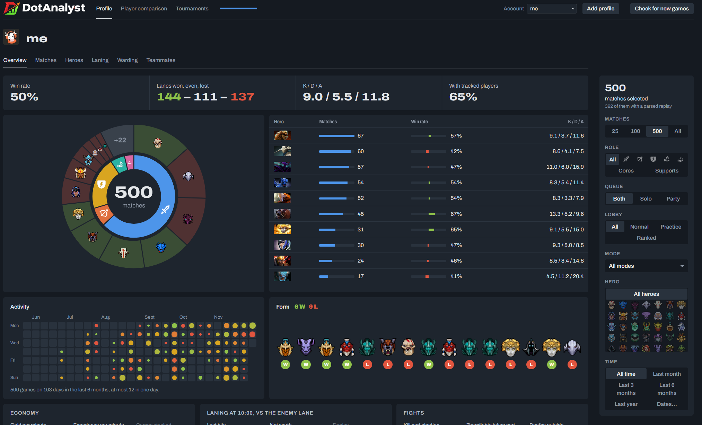

# DotAnalyst

A local Dota 2 stats site for the players I care about. There are plenty of stat sites already, but I often want numbers they don't show. This started with an amateur tournament where I wanted to analyse the opposing teams thoroughly.

How it works:
- Match data comes from Valve's Steam Web API.
- The salt each match's replay URL needs comes from Valve's game coordinator, asked by a second Steam account (`steam/salts.mjs`), or else from the [OpenDota API](https://docs.opendota.com).
- Replays are parsed by [odota/parser](https://github.com/odota/parser), OpenDota's replay parser, built with its own trimmed Java runtime and started by the server.



## Setup

The setup is written for Windows; every command runs in PowerShell, in the repo folder. You need [uv](https://docs.astral.sh/uv/) (it installs Python 3.14 itself), [Node.js](https://nodejs.org) and [git](https://git-scm.com).

1. Install the Python packages:
   ```powershell
   uv sync
   ```
2. Build the replay parser into `build\parser`. The first time it downloads Java 21 and Maven into `build\tools` (a few minutes), so nothing gets installed. The server starts the parser and stops it again. It listens on localhost only, because it fetches any URL it is given.
   ```powershell
   powershell -ExecutionPolicy Bypass -File packaging\build_parser.ps1
   ```
   A parser that already answers on port 5600, such as one in Docker, is used instead.
3. Get a Steam Web API key at <https://steamcommunity.com/dev/apikey>. This line asks for it and saves it in a file `.env` in the repo folder, replacing one that is there:
   ```powershell
   Set-Content .env "STEAM_API_KEY=$(Read-Host 'Steam API key')"
   ```
   `.env` is in `.gitignore`, so git never commits it. The commands and the server read it when it is there. Without it the site still runs and step 4 still works, but no new matches are fetched, and the site asks for the key at the top of the page, saving it in `.env` itself.
4. Fetch hero and item names:
   ```powershell
   uv run python -m dotanalyst sync-constants
   ```
5. Build the site. `npm.cmd` rather than `npm`, because PowerShell's default execution policy blocks the `npm.ps1` script:
   ```powershell
   cd frontend
   npm.cmd install
   npm.cmd run build
   cd ..
   ```
6. Start it at <http://127.0.0.1:8000>. While it runs it checks every minute for new matches and downloads and parses their replays.
   ```powershell
   uv run uvicorn dotanalyst.api:app
   ```
   Or as a desktop app in its own window, without a browser. It closes the server and the parser with the window, and refreshes the hero and item names at every start:
   ```powershell
   uv run python -m dotanalyst.app
   ```

### The Windows program

`DotAnalyst-Setup.exe` installs DotAnalyst for the current user, without admin rights, with a Start menu entry. The program bundles Python, the site and the parser with its Java runtime, so it needs nothing else installed. To build the setup into `build\installer`, install [Inno Setup 6](https://jrsoftware.org/isinfo.php) (`winget install JRSoftware.InnoSetup`) and run:

```powershell
powershell -ExecutionPolicy Bypass -File packaging\build.ps1 -Version 0.1.0
```

It builds the parser, the site and `build\dist\DotAnalyst\DotAnalyst.exe` (PyInstaller, `packaging\dotanalyst.spec`) first. A newer setup installs over a running DotAnalyst; uninstalling keeps the data.

The program updates itself from the GitHub releases that `.github/workflows/release.yml` publishes. Every hour, the workflow checks whether [odota/parser](https://github.com/odota/parser) (which OpenDota updates for each Dota patch) has a commit the last release was not built from. Changes pushed to this repo are released only when you start the workflow with **Actions → Release → Run workflow**. Before it publishes release `v0.1.<run>`, it runs the tests, builds the setup and parses a recent pro replay from OpenDota with the new parser. When OpenDota gives no replay, it publishes anyway, and the release notes say the parser was not checked. A parser release is built from the current `main`, so it also ships whatever was pushed since the last release. At every start the program asks GitHub for the newest release and downloads a newer setup in the background. When the window is closed, the program installs it silently, so the next start runs the new version. A program built by hand with `build.ps1` checks for updates the same way; one run from the repo never does. GitHub turns the hourly schedule off after 60 days without a commit; **Actions → Release → Enable workflow** turns it back on.

The program keeps its database, `.env` and logs in `%LOCALAPPDATA%\DotAnalyst`, not in the repo folder. It cannot ask the second Steam account for replay salts (that needs Node.js), so it takes them from OpenDota.

## Adding players

A player is tracked by their Dota account id, the short number (8 to 10 digits), not the 17-digit Steam id. To find it:

- in Dota 2, open the player's profile: it is the **Friend ID** under their name;
- or take the number at the end of their [OpenDota](https://www.opendota.com), [Dotabuff](https://www.dotabuff.com) or [STRATZ](https://stratz.com) profile URL, e.g. `opendota.com/players/12345678`;
- or, from a Steam profile URL `steamcommunity.com/profiles/7656119...`, subtract 76561197960265728 from that number.

Then add it with **Add profile** at the top of the site; it takes the Steam id too. Or from the command line, with an optional name for the Account menu:

```powershell
uv run python -m dotanalyst add-account 12345678 "Player 1"
uv run python -m dotanalyst sync
```

`sync` fetches the account's last 500 matches at once; the running server picks a new account up within a minute either way. On a profile, **Add frequent teammates** adds every player with 10 or more games on that player's team in their last 500 matches. The player must have **Expose Public Match Data** on (Dota 2 → Settings → Options → Social), or Steam returns no matches; `status` then says so.

Stop tracking an account, or list the tracked accounts and their replay counts:

```powershell
uv run python -m dotanalyst remove-account 12345678
uv run python -m dotanalyst status
```

## Keeping player ids out of the repo

Run this once per clone to turn on a pre-commit check that refuses files holding the account id or Steam id of any player in the local database. Test fixtures use made-up ids and names.

```powershell
git config core.hooksPath .githooks
```

## Scouting league teams

The Teams tab of the Tournaments page shows, for every team of the tracked tournaments, which heroes are banned against it, whether it picks them when they are open, and who plays what. The replays of games from the last 90 days are fetched by the running server; an older game's when you ask for it on the page; with replays a team page also shows where each player wards and where the team walks in the first seconds of a game.

This fetches the games of the tracked tournaments; the first run for a big league (500 games) takes about ten minutes:

```powershell
uv run python -m dotanalyst sync-leagues
```

After that, the running server gets the newest ones every minute, and the button "Check for new league games" on the Tournaments page at once.

### Adding a tournament

A new database tracks no tournament. To add one:

1. Find the league id: it is the number in the league's URL on [OpenDota](https://www.opendota.com/leagues) (`opendota.com/leagues/12345`) or [Dotabuff](https://www.dotabuff.com/esports/leagues) (`dotabuff.com/esports/leagues/12345-my-cup`). Only leagues Valve itself lists (the ones with an in-game ticket) can be fetched; those sites list exactly those.
2. Enter it on the Tournaments page under **Add tournament**. Its name comes from OpenDota.
3. The running server reads its games on its next check for league games; `sync-leagues` does it at once.

Steam lists only the newest 500 games of a league, so a bigger league misses its oldest games.

## Replay salts from a second Steam account

Optional; without it OpenDota is asked, which can take hours to know a new match. Use an account you do not play on: the script shows it as playing Dota 2.

1. Install the script's packages:
   ```powershell
   cd steam
   npm.cmd install
   cd ..
   ```
2. Add the account to `.env` (this keeps the lines already there):
   ```powershell
   Add-Content .env "STEAM_ALT_USER=$(Read-Host 'Steam user')"
   Add-Content .env "STEAM_ALT_PASSWORD=$(Read-Host 'Steam password')"
   ```
3. Log in once and type the Steam Guard code it asks for. It prints `{}` when the login worked.
   ```powershell
   node --env-file=.env steam/salts.mjs
   ```
4. Restart the server.
